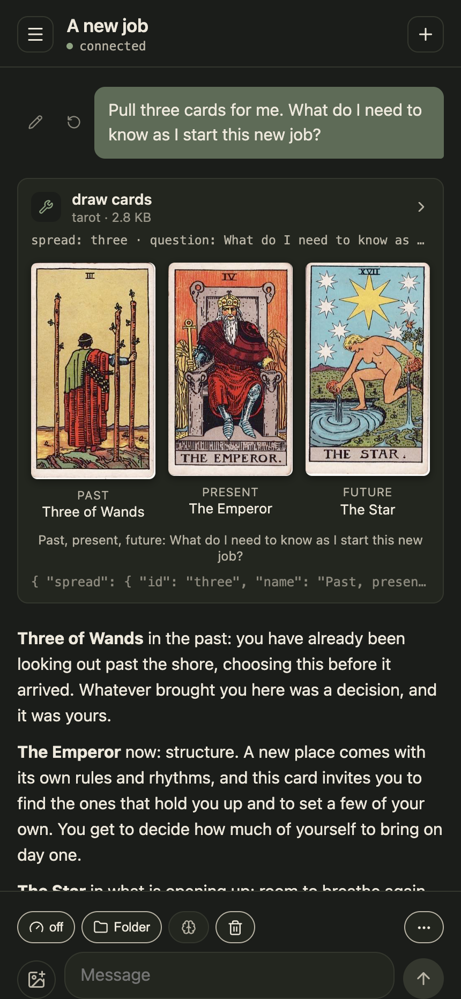

#  LM Chat

A mobile web client for [LM Studio](https://lmstudio.ai). Run a model on
your computer and chat with it from your phone over Tailscale, including
the MCP tools you already have set up in LM Studio.

Everything stays on your network: no cloud service, no account, no
third-party API.

## What it looks like


On a desktop the chat list sits in a sidebar beside the thread.


<p>On a desktop, a question is typed into a chat and the local model answers it, streaming as it writes.</p>

<p align="center"></p>

<p align="center">The same flow on a phone.</p>

<table>
  <tr>
    <td align="center" valign="top" width="33%"><br /><b>Tools and reasoning</b><br /><sub>The model's thinking as a row, each MCP tool it called as a card, then the reply</sub></td>
    <td align="center" valign="top" width="33%"><br /><b>Rich tool results</b><br /><sub>Some tools draw: a tarot spread as its cards, a birth chart as a wheel</sub></td>
    <td align="center" valign="top" width="33%"><br /><b>Chats</b><br /><sub>Folders, stars and search; each chat keeps its own reasoning and memory settings</sub></td>
  </tr>
</table>

The screenshots use demo data. To regenerate them:

```bash
npm run seed:demo                                  # once
MEMORY_DB=$PWD/.data-dev/memory.sqlite npm run dev  # one terminal
npm run screenshots                                # another; needs Google Chrome
```

## Features

- **Streaming replies** with live status: loading, reading the prompt,
  reasoning, writing, or calling a tool.
- **Reasoning shown, not discarded**, as a collapsible "Thought for 4.2s"
  block.
- **MCP tool calls** rendered as cards with their arguments and output.
- **Conversations saved on your computer**, so they survive a closed tab or
  a locked phone and are shared across your devices. Folders, stars and
  search keep them in order.
- **Several chats at once.** Switch between chats while they reply. Extra
  messages wait their turn instead of overloading the model.
- **Memories.** What the model has learned about you, kept in a file you
  can read and edit, and offered to each chat or left out of it.
- **Read aloud.** Each reply can be spoken by a local voice model.
- **Per-chat reasoning effort**, offering only the levels the loaded model
  accepts.
- **Automatic context compaction.** Long threads have their older turns
  summarized, so each message stays fast without the model losing track.

## Before you start

### How it fits together

```
your phone or desktop browser
        │  https, through Tailscale Serve
        ▼
LM Chat ── one Node process on one computer ── .data/ (SQLite)
        │
        ├──▶ a model server on the same computer   (every reply; MCP tools run inside it)
        └──▶ a speech server, optional             (read aloud)
```

LM Chat is one Node process that serves the app and keeps your
conversations in SQLite on that computer. It listens only on 127.0.0.1;
Tailscale Serve is what puts it on your phone. Your phone
talks only to LM Chat. LM Chat talks to the model server, streams the reply
back and saves it, which is why a reply keeps going when the phone locks
and why the server's token never reaches the browser. MCP tools are set up
in the model server, not here; LM Chat shows them and lets each chat choose
among them.

### What you need

| For | You need |
|---|---|
| Chatting | Node 24 or newer, and a model server with a chat model (below) |
| Calling tools from a chat | MCP servers registered with the model server, and its authentication on |
| Memories | The [lm-memory-mcp](https://github.com/akuttruff/lm-memory-mcp) server registered the same way; the model uses it to remember and forget |
| Reading replies aloud | A local speech server (below) |
| Opening it on your phone | [Tailscale](https://tailscale.com) on both devices, with Tailscale Serve in front of LM Chat (see *Development*) |

Node 24 is the floor because conversations are stored with `node:sqlite`,
which arrived in that version. Check with `node --version`.

### A model server

LM Chat sends each turn to a model server's `/api/v1/chat` endpoint, the
API that [LM Studio](https://lmstudio.ai) 0.4 introduced, because it
carries MCP tool calls, reasoning levels, images and streamed replies in
one request. LM Studio is the server these steps use. Any other server
that implements that same API works the same way; one that offers only
the OpenAI chat API does not, yet. The server can run on the same computer
as LM Chat or on one it can reach.

1. Install the server and download a chat model. In LM Studio that is the
   Discover tab. LM Chat is written and tested against `qwen/qwen3.8-27b`;
   any chat model works, and a smaller one answers faster.
2. Start the server. In LM Studio that is the **Developer** tab. It listens
   on `http://127.0.0.1:1234`, LM Chat's default; Settings takes another
   address.
3. Turn authentication on and create a token. In LM Studio: **Require
   Authentication**, then **Manage Tokens**. LM Studio requires this for MCP
   tools. The token is kept on the LM Chat server and never sent to the
   browser.
4. For tools, register the MCP servers you want with the model server. In
   LM Studio that is `~/.lmstudio/mcp.json` plus **Allow calling servers
   from mcp.json** in the Developer settings. LM Chat reads that same file
   to show each server's tools in its tool picker.
5. Set how many requests the model serves at once (in LM Studio, the
   model's **Parallel** setting) and match it in LM Chat's Settings.

### A speech server

Read-aloud needs a server that speaks the OpenAI `/v1/audio/speech` API on
`127.0.0.1:8020`. `scripts/lm-speech` starts
[mlx-audio](https://github.com/Blaizzy/mlx-audio) with the Kokoro voice on
an Apple Silicon Mac; its header says how to set that environment up once
with `uv`. Any server with the same endpoint works, with `LM_SPEECH_URL`
and `LM_SPEECH_MODEL` pointing at it. Without one, the speak button
reports that no voice is running.

## Setup

1. Get a model server running, as above.
2. Install and run:

   ```bash
   npm install
   npm run dev
   ```

3. Open `http://127.0.0.1:8000/` on the same computer. To open it on your
   phone, put it behind Tailscale Serve (see *Development*) and open the
   `https://` address that prints.
4. Tap the gear, enter the model server's address if it is not the
   default, paste its token, tap **Test connection**, and pick a model.

> Paste the token rather than typing it. Tokens are case-sensitive, and
> some apps lowercase part of them when copying. The Settings screen warns
> if the token looks mangled.

## How it works

```
Phone browser                     Your computer (one Node process, :8010)        LM Studio :1234
┌──────────────┐  HTTPS via      ┌───────────────────────────────────────┐        ┌───────────┐
│ service      │  tailscale      │ Vite preview serving the built page   │        │ the model │
│ worker:      │  serve          │ + the API as a Vite plugin            │──────▶ │ + MCP     │
│ cached shell │ ─────────────▶  │   api.ts → engine.ts → store.ts       │ stream │ tools     │
│ React app    │ ◀── SSE ──────  │              bus.ts (pub/sub)         │◀────── │           │
└──────────────┘ /api/events     │   SQLite + files in .data/            │        └───────────┘
                                 └───────────────────────────────────────┘
```

The page is a cached shell; everything else is the server's. The browser
sends what you asked for and draws what the server reports over one
server-sent event stream, `/api/events`: the whole chat list when it
connects, then only what changes (a reply in progress, a rename, a status).
Two devices on the same chat always agree, because neither keeps its own
copy.

The phone never talks to LM Studio directly. The LM Chat server sends each
message to LM Studio, streams the reply back, and saves it. So:

- **A reply keeps going** if you lock your phone or close the tab.
- **Your API token stays on your computer.** It is never sent to the
  browser.
- **Data lives in `.data/`** in the project folder, as SQLite. It is
  git-ignored. `npm run dev` uses a scratch copy in `.data-dev/`.

Each message carries its own conversation history rather than relying on
LM Studio's server-side chat state, so one failed reply cannot make the
model forget the thread. When that history grows past the budget set in
Settings, the older turns are replaced by a summary the model writes.

The page itself is served from the browser's cache on every launch, so the
app opens at once on the phone even before its network is up, and shows a
notice if the server cannot be reached.

## Settings

| Setting | Notes |
|---|---|
| LM Studio address | Defaults to `http://127.0.0.1:1234`. |
| Model | Filled in by **Test connection**. |
| API token | Required when LM Studio has authentication on. |
| System prompt | Sent with every message. |
| Default reasoning effort | For new chats; each chat can override it. |
| Give up after | Seconds of *silence* before a reply is abandoned. `0` waits forever. |
| Parallel replies | How many chats can be answered at once (default 4). Match the model's **Parallel** setting in LM Studio. `0` means no limit. |
| Conversation replayed | Characters of history sent with each message (default 24000). Older turns are summarized. `0` sends everything. |
| Context length | Leave blank. Setting it here makes LM Studio load a new model instance for every message. |
| Plugin IDs | MCP plugins to enable, comma-separated, for example `mcp/filesystem, mcp/web-search`. |

## Development

```bash
npm run dev          # dev server on 127.0.0.1:8000
npm test             # run the test suite
npm run coverage     # coverage report
npm run check        # typecheck, lint and test
npm run deploy       # build and restart the persistent instance on :8010
npm run seed:demo    # fill the dev database with demo chats and memories
npm run screenshots  # regenerate docs/screenshots/ from the dev server
```

The persistent instance is a launchd job (`com.amie.lm-chat`) running
`vite preview` on :8010. Read-aloud needs the companion `com.amie.lm-speech`
job, which runs Kokoro on :8020 (see `scripts/lm-speech`). To reach it from
anywhere, put :8010 behind Tailscale Serve:

```bash
/Applications/Tailscale.app/Contents/MacOS/Tailscale serve --bg --https=8443 http://127.0.0.1:8010
```

## Limitations

- **No authentication on the app itself.** It listens only on 127.0.0.1,
  so what reaches it is Tailscale Serve, and through it, the devices on
  your tailnet. Anyone on your tailnet can read your conversations and
  change settings.
- **Single user.** There are no accounts, and two devices editing the same
  conversation at once can overwrite each other.

## License

[MIT](LICENSE)
